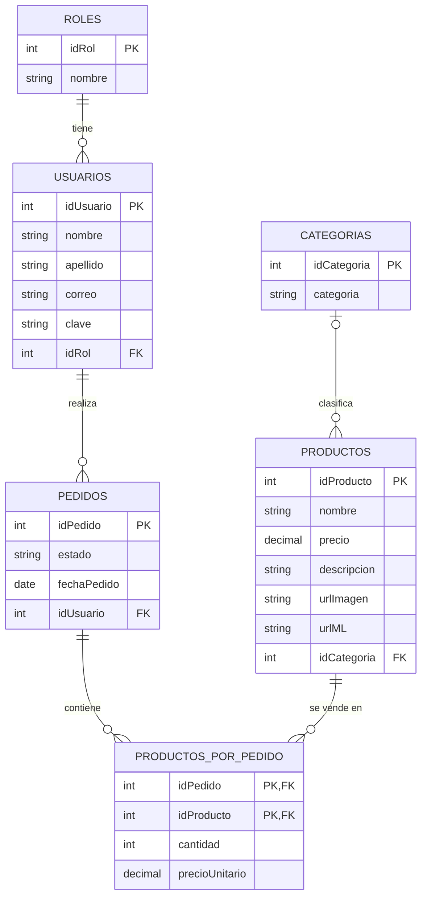

# Beomys Crochet

Página web de un emprendimiento de cosas hechas a crochet. Todos pueden ver los productos, y los administradores pueden agregar, editar y borrar productos, categorías y usuarios.

**Autor:** [Fisch Serena] · **Docente:** [Casali Analía] · **Materia:** Programación I · **Año:** 2025

## Tecnologías

- Java 21
- Jakarta EE 11 (Servlets y JSP con JSTL)
- Tomcat 11
- MySQL 8.4
- Maven
- Bootstrap 5

## Qué hace

- Cualquier persona puede ver el catálogo de productos.
- Se puede crear una cuenta (registro) e iniciar sesión.
- Hay dos roles: **CLIENTE** y **ADMIN**.
- Solo el **ADMIN** puede hacer el CRUD (crear, ver, editar y borrar) de **productos**, **categorías** y **usuarios**.
- Las contraseñas se guardan con hash (BCrypt), nunca en texto plano.
- Hay validaciones en el navegador y en el servidor (en el registro, las categorías y los usuarios).

## Cómo está hecho

El proyecto está dividido en capas:

**JSP (lo que ve el usuario) → Servlet (decide qué hacer) → DAO (consultas SQL) → MySQL**

```
src/main/java/org/proyecto/
    dao/          acceso a la base de datos
    servlets/     controladores
    entities/     clases que representan los datos
    interfaces/   conexión a la base e interfaz Dao
    util/         hash de contraseñas
src/main/webapp/  páginas JSP
sql/crochet.sql   script de la base de datos
```

## Base de datos

El script `sql/crochet.sql` crea la base `crochet` con sus tablas, claves foráneas y datos de prueba.



## Cómo ejecutarlo

1. Tener instalados JDK 21, Maven, MySQL 8.4 y Tomcat 11.
2. Clonar el repositorio:
   ```
   git clone https://github.com/Serena-08/Beomys_crochet.git
   ```
3. Crear la base de datos: abrir `sql/crochet.sql` en MySQL Workbench (*File → Open SQL Script*) y ejecutarlo completo.
4. Revisar el usuario y la contraseña de MySQL en `src/main/java/org/proyecto/interfaces/AdministradorConexiones.java`.
5. Ejecutar el proyecto en Tomcat 11 (en IntelliJ, con el plugin Smart Tomcat y el contexto `/Beomys_crochets`).
6. Abrir `http://localhost:8080/Beomys_crochets/` en el navegador.

## Usuarios de prueba

| Usuario | Contraseña | Rol |
|---|---|---|
| `admin` | `admin` | ADMIN |
| `cliente` | `cliente` | CLIENTE |

## Mejoras pendientes

- Hacer una pantalla para que los clientes armen pedidos (las tablas y las clases ya están creadas).
- Usar un pool de conexiones en lugar de abrir una conexión nueva en cada consulta.
- Agregar validación en el servidor al formulario de productos.